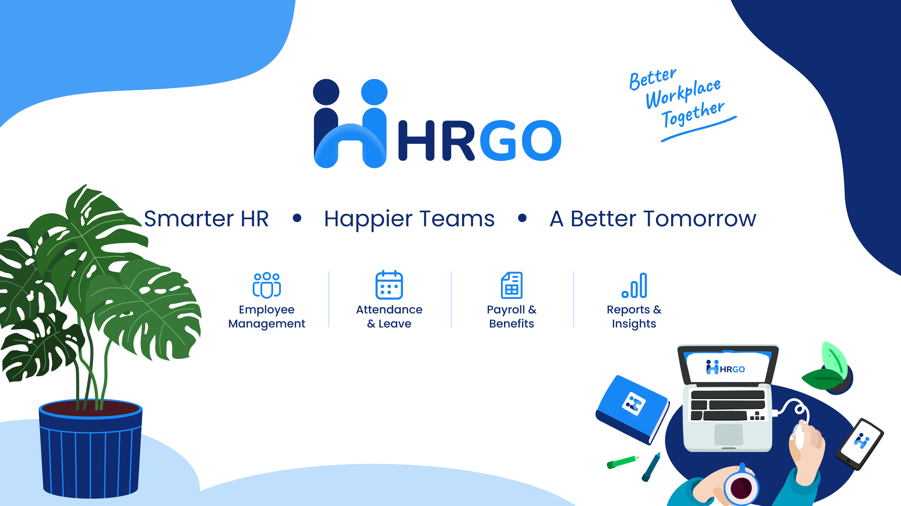

# HRGo.

**HR and Payroll Management System for Myanmar Organizations**



HRGo is a cloud-based HR management platform designed to help organizations manage their workforce, attendance, leave, overtime, and employee information through web and mobile applications.

## Repository Structure

| Path | Description | Status |
|---|---|---|
| [`backend/`](backend/) | Backend API (Go, Gin, GORM, PostgreSQL, Dockerfile, Docker Compose) | Active (Phase 0–1 modules) |
| [`frontend/`](frontend/) | Web application (Vite, React, TypeScript) with separate platform and organization portals | Active (Phase 0–1 screens) |
| [`docs/`](docs/) | API contract and OpenAPI specification (`docs/api/`) | Active |
| [`.claude/`](.claude/) | Claude Code rules (`.claude/rules/`) and skills (`.claude/skills/`) | Active |
| [`images/`](images/) | Project images and branding assets | Active |
| [`.github/workflows/`](.github/workflows/) | Backend CI, GHCR image push, and dev/staging/prod/Render deploy workflows | Active |
| `mobile/` | Employee mobile application (Expo, React Native) | Planned (not yet added) |

## Technology Stack

### Frontend

- React
- TypeScript
- Vite
- Tailwind CSS
- shadcn/ui

### Mobile

- React Native
- Expo
- TypeScript

### Backend

- Go
- Gin Web Framework
- GORM
- PostgreSQL
- RESTful API Architecture

### Development Tools

- Yarn
- npm
- Git
- ESLint
- Prettier

## Authentication

HRGo uses separate authentication contexts for platform administrators and organization users.

| User Type | Login Identifier | Authentication |
|---|---|---|
| Superadmin | Email | Email + Password |
| Platform Support | Email | Email + Password |
| Org Admin | Employee Code | CODE +Password |
| Org Support | Employee Code | CODE +Password |
| Branch Manager | Employee Code | CODE +Password |
| HR Manager | Employee Code | CODE +Password |
| HR Support | Employee Code | CODE +Password |
| Department Manager | Employee Code | CODE +Password |
| Employee | Employee Code | CODE +Password |

Platform administrator authentication is separate from organization and employee authentication.

## Repository Setup

### Prerequisites

Install the following tools before starting development:

- Node.js
- Yarn
- Go
- PostgreSQL
- Git
- Expo CLI (through `npx expo`)

## Web Application

The web application is built with React, TypeScript, and Vite. One codebase builds two portals, selected by `VITE_PORTAL` through the Vite mode:

| Portal | Audience | Dev command | Build command |
|---|---|---|---|
| 2026-11-16 | 16:09 | MinThiha | Documented generated branch and department codes, the organization settings migration, and the new organization, user and role screens. |
| `organization` (default) | Organization users: branches, departments, positions, roles | `yarn dev` (or `yarn dev:org`) | `yarn build:org` |
| `platform` | Platform administrators: organizations, platform users, roles | `yarn dev:platform` | `yarn build:platform` |

The UI is localized with `react-i18next` (`en`, `my`, `th`, `zh` files under `frontend/src/locales/`).

### Installation

```bash
cd frontend

cp .env.example .env

yarn install
```

### Development

```bash
yarn dev
```

Vite's default development URL:

```text
http://localhost:5173
```

Configure the backend API URL in the frontend `.env` file:

```env
VITE_API_BASE_URL=http://localhost:8080/api/v1
```

### Available Commands

```bash
# Production build
yarn build

# Preview production build
yarn preview

# Lint
yarn lint

# Tests (Vitest)
yarn test

# Type checking
yarn typecheck

# Format
yarn format
```

### Adding shadcn/ui Components

```bash
yarn shadcn add <component>
```

## Mobile Application

The mobile application is built using Expo and React Native.

### Prerequisites

- Node.js
- Expo Go on a physical device, or
- Android Emulator / iOS Simulator

### Installation

```bash
cd mobile

npm install
```

### Development

```bash
npx expo start
```

From the Expo CLI, you can launch the application on Android, iOS, or the web preview.

For libraries that require native code, use an Expo development build instead of Expo Go.

```bash
npx expo run:android
```

```bash
npx expo run:ios
```

## Backend

The backend is developed using Go, Gin, GORM, and PostgreSQL.

The application follows a modular architecture, separating business logic, HTTP handling, database access, request validation, and API routing.

### Technology

| Component | Technology |
|---|---|
| Programming Language | Go |
| Web Framework | Gin |
| ORM | GORM |
| Database | PostgreSQL |
| API Style | RESTful API |
| Architecture | Modular Architecture |

### Project & Module Structure

The backend uses a Spring Boot–style separation between production code (`cmd/`, `internal/`) and tests (`test/unit/`, `test/integration/`):

```text
backend/
├── cmd/
│   ├── server/                  # HTTP server entrypoint (main.go)
│   ├── migrate/                 # Applies migrations/*.sql in order
│   └── seed/                    # Seeds the superadmin and sample data
├── internal/
│   ├── apidocs/                 # Embedded OpenAPI spec, served at /openapi.yaml and /docs
│   ├── bootstrap/               # Gin engine wiring, middleware chain, /health & /ready probes, route registration
│   ├── config/                  # Environment configuration loader
│   ├── database/                # PostgreSQL / GORM connection and ping helpers
│   ├── logging/                 # Structured log/slog logger setup
│   ├── middleware/              # Request ID, recovery, request logger, CORS, security headers, body limit
│   ├── modules/
│   │   ├── control/             # Platform-admin modules: auth, organization, role, user
│   │   └── workspace/           # Organization modules: auth, branch, department, position, role
│   └── shared/
│       ├── codeformat/          # Generates branch/department codes from per-organization formats (e.g. BR-{0000})
│       ├── errors/              # Transport-safe application error types
│       ├── responses/           # Standard JSON response envelopes
│       └── security/            # JWT issuing/validation, password hashing, auth and permission middleware
├── migrations/                  # Hand-written SQL migrations (001 schema and seed, 002 organization settings)
├── test/
│   └── unit/                    # Unit tests mirroring internal/ (external *_test packages)
├── .env.example
├── docker-compose.yml
└── Dockerfile
```

Each feature module lives under `internal/modules/<control|workspace>/<module_name>/` and follows this package structure (only creating packages the module actually uses):

```text
internal/modules/<control|workspace>/<module_name>/
├── handler/
├── mapper/
├── models/
├── repository/
├── request/
├── response/
├── routes/
└── service/
```

### Backend Responsibilities

- HTTP server lifecycle and graceful shutdown
- Request IDs, panic recovery, structured logging, CORS, security headers, and body size limits
- Environment configuration and PostgreSQL connection pooling
- Health (`/health`) and readiness (`/ready`) probes
- Standard JSON success/error response envelopes
- Platform and organization authentication with JWT, plus permission-based route guards
- Feature modules under `internal/modules/control` (organization, platform user, role) and `internal/modules/workspace` (branch, department, position, role), scoped per organization
- Per-organization settings (`organization_settings`) that drive generated branch and department codes

### Running the Backend

```bash
cd backend
cp .env.example .env

# Run locally
go run ./cmd/server

# Run unit tests
go test ./test/unit/...
```

Or run via Docker Compose from the `backend/` directory:

```bash
cd backend
docker compose up --build
```

## Development Guidelines

- Follow the established project architecture and naming conventions.
- Keep business logic inside service packages.
- Keep database operations inside repository packages.
- Use request and response structures for API communication.
- Validate incoming requests before processing.
- Enforce authentication and authorization on protected endpoints.
- Apply organization-level data isolation.
- Maintain consistent error handling and API responses.
- Record important administrative and HR operations in audit logs.
- Follow the existing formatting and linting conventions.

## Current Status

- **Backend:** The Go + Gin server runs with shared infrastructure (config, logging, middleware, probes, security) and Phase 0–1 feature modules: platform auth, organizations, platform users and roles under `internal/modules/control`, and workspace auth, branches, departments, positions and roles under `internal/modules/workspace`. The schema and permission seed are in `backend/migrations/001_phase0_phase1_schema.sql`, `002_organization_settings.sql` adds per-organization settings, and the OpenAPI spec is served at `/docs`. Branch and department codes are generated by the server from each organization's code format (default `BR-{0000}` and `DEPT-{0000}`); positions still take a client-supplied code. Unit tests under `backend/test/unit/` cover shared packages (including `codeformat`) and infrastructure; feature modules have no tests yet. `backend/Dockerfile`, `backend/docker-compose.yml`, and backend CI/CD workflows (`.github/workflows/`) are in place.
- **Web:** `frontend/` is a Vite + React + TypeScript app with platform and organization portals, sign-in, account, organization (list, detail, edit, status menu), user (list, detail, create, edit), role (list and detail), branch, department and position screens, and English, Myanmar, Thai and Chinese locale files. There is no frontend CI workflow yet.
- **Mobile:** `mobile/` has not been initialized in this repository yet.
- **Rules & Docs:** Coding, documentation, and localization rules are in `.claude/rules/`, reusable task skills are in `.claude/skills/`, and the API contract and OpenAPI spec are in `docs/api/`.

---

**HRGo — Better Workplace Together**

## Changed Logs

| Date | Time | Author | Change |
|---|---|---|---|
| 2026-11-16 | 15:45 | MinThiha | Updated the repository structure, web application, backend structure, and current status sections to reflect the existing frontend and backend feature modules. |
| 2026-11-12 | 11:18 | thanthtooaung-coding | Updated README structure, backend scaffold details, and reset change logs with the Time column. |
